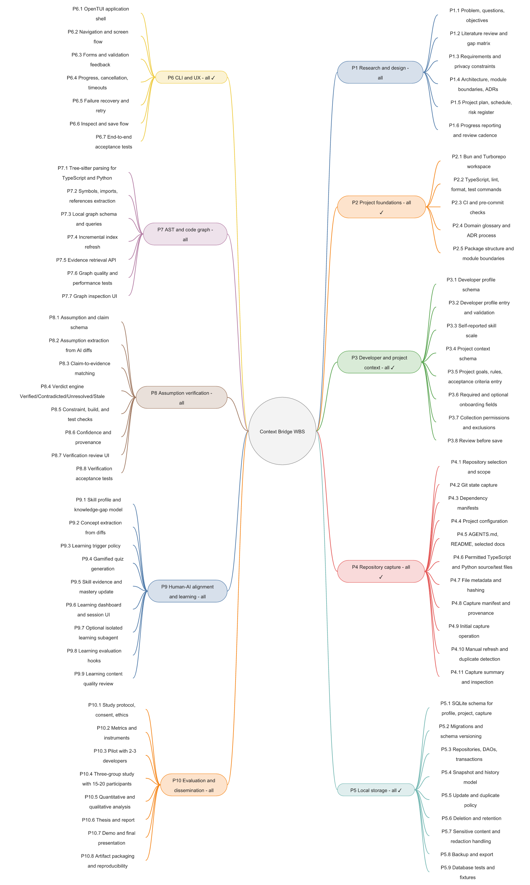

# Work breakdown structure

Status: draft for review. The scope covers the whole project; only selected work is
in the current implementation increment.

Sources: [presentation.pdf](presentation.pdf) and
[data-collection-design.md](data-collection-design.md).

## Team

| Member | Primary responsibility |
| --- | --- |
| Pruthivi Thejan | Frontend, CLI, and integration |
| Nuwan Konara | Backend, local storage, and database |
| Raviru Rathnaweera | Project management, research, verification, and evaluation |

## Assignment rule

Every phase has at least one task for each member. Tasks follow the primary role:
Pruthivi owns frontend and integration, Nuwan owns backend and storage, and Raviru
owns project management, research, verification, learning, and evaluation.

The diagram labels each phase `all` for that reason. The tables below give the
task-level owner.

## Diagram

Pele renders the WBS from [work-breakdown-structure.mmd](work-breakdown-structure.mmd)
into SVG, then `@resvg/resvg-js` converts it to PNG.

- [work-breakdown-structure.svg](work-breakdown-structure.svg)
- [work-breakdown-structure.png](work-breakdown-structure.png)

Run `bun run wbs:render` after editing the Mermaid source.

Legend: `✓` marks a work package selected for the first implementation increment.
Task-level selection and completion are tracked separately in
[wbs-progress.md](wbs-progress.md).

## Current increment

The first increment collects and stores context locally.

In scope:

- Developer profile, reused across projects.
- Project context: goals, rules, and acceptance criteria.
- Repository context selected and captured on explicit request.
- Git state, dependency manifests, project configuration, `AGENTS.md`, `README`,
  selected documentation, and permitted TypeScript and Python source and test files.
- CLI built with OpenTUI.
- Local SQLite storage.
- Inspect, save, and manually refresh the captured context.

Out of scope for this increment:

- AST and code-graph extraction.
- Assumption verification.
- Developer learning and gamification.
- CV import and inferred skill assessment.
- Remote or optional external learning services.

## Work packages

### 1. Research and design

| ID | Work package | Owner | Session |
| --- | --- | --- | --- |
| 1.1 | Confirm problem statement, research questions, and objectives | Raviru Rathnaweera | |
| 1.2 | Complete literature review and gap matrix | Raviru Rathnaweera | |
| 1.3 | Define requirements and privacy constraints | Nuwan Konara | |
| 1.4 | Define architecture, module boundaries, and ADRs | Pruthivi Thejan | |
| 1.5 | Maintain project plan, schedule, and risk register | Raviru Rathnaweera | |
| 1.6 | Run progress reporting and review cadence | Raviru Rathnaweera | |

### 2. Project foundations

| ID | Work package | Owner | Session |
| --- | --- | --- | --- |
| 2.1 | Configure Bun and Turborepo workspace | Pruthivi Thejan | ✓ |
| 2.2 | Configure TypeScript, lint, format, and test commands | Pruthivi Thejan | ✓ |
| 2.3 | Add CI and pre-commit checks | Nuwan Konara | ✓ |
| 2.4 | Establish domain glossary and ADR process | Raviru Rathnaweera | ✓ |
| 2.5 | Define package structure and module boundaries | Nuwan Konara | ✓ |

### 3. Developer and project context

| ID | Work package | Owner | Session |
| --- | --- | --- | --- |
| 3.1 | Design developer profile schema | Pruthivi Thejan | ✓ |
| 3.2 | Implement developer profile entry and validation | Pruthivi Thejan | ✓ |
| 3.3 | Define self-reported skill scale | Raviru Rathnaweera | ✓ |
| 3.4 | Design project context schema | Nuwan Konara | ✓ |
| 3.5 | Implement project goals, rules, and acceptance criteria entry | Pruthivi Thejan | ✓ |
| 3.6 | Decide required and optional onboarding fields | Raviru Rathnaweera | ✓ |
| 3.7 | Implement collection permissions and exclusions | Nuwan Konara | ✓ |
| 3.8 | Add review before save | Pruthivi Thejan | ✓ |

### 4. Repository capture

| ID | Work package | Owner | Session |
| --- | --- | --- | --- |
| 4.1 | Implement repository selection and scope | Pruthivi Thejan | ✓ |
| 4.2 | Capture Git state | Nuwan Konara | ✓ |
| 4.3 | Capture dependency manifests | Nuwan Konara | ✓ |
| 4.4 | Capture project configuration | Nuwan Konara | ✓ |
| 4.5 | Capture `AGENTS.md`, `README`, and selected documentation | Nuwan Konara | ✓ |
| 4.6 | Capture permitted TypeScript and Python source and test files | Nuwan Konara | ✓ |
| 4.7 | Capture file metadata and hashes | Nuwan Konara | ✓ |
| 4.8 | Record capture manifest and provenance | Raviru Rathnaweera | ✓ |
| 4.9 | Implement initial capture operation | Nuwan Konara | ✓ |
| 4.10 | Implement manual refresh and duplicate detection | Nuwan Konara | ✓ |
| 4.11 | Implement capture summary and inspection | Pruthivi Thejan | ✓ |

### 5. Local storage

| ID | Work package | Owner | Session |
| --- | --- | --- | --- |
| 5.1 | Design SQLite schema for profiles, projects, and captures | Nuwan Konara | ✓ |
| 5.2 | Implement migrations and schema versioning | Nuwan Konara | ✓ |
| 5.3 | Implement repositories, DAOs, and transactions | Nuwan Konara | ✓ |
| 5.4 | Implement snapshot and history model | Nuwan Konara | ✓ |
| 5.5 | Define update and duplicate policy | Raviru Rathnaweera | ✓ |
| 5.6 | Implement deletion and retention | Nuwan Konara | ✓ |
| 5.7 | Define sensitive content and redaction policy | Raviru Rathnaweera | ✓ |
| 5.8 | Implement backup and export interface | Pruthivi Thejan | ✓ |
| 5.9 | Add database tests and fixtures | Nuwan Konara | ✓ |

### 6. CLI and user experience

| ID | Work package | Owner | Session |
| --- | --- | --- | --- |
| 6.1 | Build OpenTUI application shell | Pruthivi Thejan | ✓ |
| 6.2 | Implement navigation and screen flow | Pruthivi Thejan | ✓ |
| 6.3 | Implement forms and validation feedback | Pruthivi Thejan | ✓ |
| 6.4 | Add progress, cancellation, and timeouts | Pruthivi Thejan | ✓ |
| 6.5 | Implement failure recovery and retry | Nuwan Konara | ✓ |
| 6.6 | Implement inspect and save flow | Pruthivi Thejan | ✓ |
| 6.7 | Add end-to-end acceptance tests | Raviru Rathnaweera | ✓ |

### 7. AST and code graph

| ID | Work package | Owner | Session |
| --- | --- | --- | --- |
| 7.1 | Add Tree-sitter parsing for TypeScript and Python | Raviru Rathnaweera | |
| 7.2 | Extract symbols, imports, and references | Raviru Rathnaweera | |
| 7.3 | Design local graph schema and queries | Nuwan Konara | |
| 7.4 | Implement incremental index refresh | Nuwan Konara | |
| 7.5 | Implement evidence retrieval API | Nuwan Konara | |
| 7.6 | Add graph quality and performance tests | Raviru Rathnaweera | |
| 7.7 | Build graph inspection UI | Pruthivi Thejan | |

### 8. Assumption verification

| ID | Work package | Owner | Session |
| --- | --- | --- | --- |
| 8.1 | Define assumption and claim schema | Raviru Rathnaweera | |
| 8.2 | Extract assumptions from AI-generated diffs | Raviru Rathnaweera | |
| 8.3 | Match claims to workspace evidence | Raviru Rathnaweera | |
| 8.4 | Implement verdict engine | Nuwan Konara | |
| 8.5 | Add constraint, build, and test checks | Nuwan Konara | |
| 8.6 | Record confidence and provenance | Raviru Rathnaweera | |
| 8.7 | Build verification review UI | Pruthivi Thejan | |
| 8.8 | Add verification acceptance tests | Raviru Rathnaweera | |

### 9. Human-AI alignment and learning

| ID | Work package | Owner | Session |
| --- | --- | --- | --- |
| 9.1 | Define skill profile and knowledge-gap model | Raviru Rathnaweera | |
| 9.2 | Extract concepts from generated diffs | Raviru Rathnaweera | |
| 9.3 | Define learning trigger policy | Raviru Rathnaweera | |
| 9.4 | Implement gamified quiz generation | Raviru Rathnaweera | |
| 9.5 | Implement skill evidence and mastery update | Nuwan Konara | |
| 9.6 | Build learning dashboard and session UI | Pruthivi Thejan | |
| 9.7 | Implement optional isolated learning subagent | Raviru Rathnaweera | |
| 9.8 | Add learning evaluation hooks | Nuwan Konara | |
| 9.9 | Review learning content quality | Raviru Rathnaweera | |

### 10. Evaluation and dissemination

| ID | Work package | Owner | Session |
| --- | --- | --- | --- |
| 10.1 | Write study protocol, consent, and ethics materials | Raviru Rathnaweera | |
| 10.2 | Define metrics and instruments | Raviru Rathnaweera | |
| 10.3 | Run pilot with 2-3 developers | Nuwan Konara | |
| 10.4 | Run three-group study with 15-20 participants | All | |
| 10.5 | Analyse quantitative and qualitative data | Raviru Rathnaweera | |
| 10.6 | Write thesis and report | All | |
| 10.7 | Prepare demo and final presentation | Pruthivi Thejan | |
| 10.8 | Package artifacts for reproducibility | Nuwan Konara | |

## Session acceptance criteria

Draft criteria for the first increment; confirm during the interview.

- A developer can enter one profile and reuse it across projects.
- A developer can create a project and enter goals, rules, and acceptance criteria.
- A developer can select a repository and exclude files or directories.
- Capture includes Git state, manifests, configuration, selected documents, and
  permitted TypeScript and Python source and test files.
- The developer can inspect a capture summary before saving.
- The developer can save and reload a local snapshot.
- A manual refresh detects unchanged files and does not duplicate them.
- Cancellation and capture failures leave saved data usable.
- The increment performs no network egress.

## Milestones

| Milestone | Work packages | Exit condition |
| --- | --- | --- |
| M1 Local context capture | 1-6 | Developer, project, and repository context can be captured, inspected, and saved locally. |
| M2 Code structure | 7 | TypeScript and Python symbols and references are indexed and queryable. |
| M3 Assumption verification | 8 | Assumptions receive evidence-backed verdicts. |
| M4 Learning loop | 9 | Knowledge gaps produce optional learning interventions. |
| M5 Evaluation | 10 | Study results and thesis are complete. |

## Open decisions

The WBS will be revised when these decisions are resolved.

- Module boundaries and the local graph tool.
- Required and optional onboarding fields and the skill scale.
- Collection permissions, exclusions, and sensitive-content handling.
- Storage location, updates, history, deletion, and duplicate captures.
- OpenTUI renderer, navigation, cancellation, and failure recovery.
- Final acceptance criteria for the first increment.
